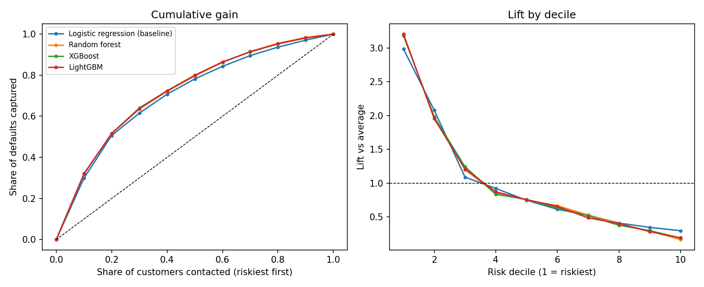

# Credit-default risk: comparison of scoring models

## Summary

We compared the existing scorecard-style model (logistic regression) with 3 machine-learning alternatives on 29,965 credit-card customers, predicting who will miss next month's payment. On the assumed cost of mistakes, the lowest-cost model was **XGBoost**.

## What the baseline does

Logistic regression gives each customer a score by adding up weighted signals (recent late payments, share of bills paid, credit use, limit, age). Each weight can be read and audited, which is why scorecards are standard in lending. It can only add effects up; it cannot capture interactions such as 'late payments matter more for customers who also use most of their limit' unless someone builds them in by hand.

## How the models compare

Numbers are the average over 5 cross-validation folds with a 95% interval across folds (indicative; folds share data, so true uncertainty is somewhat larger). Higher is better except cost.

| Model | ROC-AUC | PR-AUC | Recall | Precision | Cost per customer |
|---|---|---|---|---|---|
| Logistic regression (baseline) | 0.767 (0.751 to 0.784) | 0.522 (0.505 to 0.539) | 0.744 (0.712 to 0.776) | 0.369 (0.348 to 0.391) | 0.565 (0.539 to 0.591) |
| Random forest | 0.786 (0.774 to 0.798) | 0.561 (0.546 to 0.576) | 0.747 (0.703 to 0.791) | 0.383 (0.345 to 0.421) | 0.550 (0.532 to 0.568) |
| XGBoost | 0.788 (0.776 to 0.799) | 0.565 (0.548 to 0.581) | 0.765 (0.733 to 0.796) | 0.373 (0.349 to 0.397) | 0.547 (0.526 to 0.568) |
| LightGBM | 0.788 (0.776 to 0.799) | 0.566 (0.548 to 0.584) | 0.764 (0.733 to 0.796) | 0.373 (0.338 to 0.408) | 0.548 (0.523 to 0.573) |

**Improvement over the baseline** (same folds, difference with 95% interval; an interval that excludes 0 is a consistent difference):

| Model | Δ ROC-AUC | Δ PR-AUC | Δ Recall | Δ Cost per customer |
|---|---|---|---|---|
| Random forest | 0.0192 (0.0140 to 0.0244) | 0.0393 (0.0267 to 0.0520) | 0.0027 (-0.0528 to 0.0582) | -0.0152 (-0.0242 to -0.0061) |
| XGBoost | 0.0205 (0.0148 to 0.0262) | 0.0428 (0.0303 to 0.0553) | 0.0207 (-0.0396 to 0.0810) | -0.0184 (-0.0287 to -0.0081) |
| LightGBM | 0.0206 (0.0153 to 0.0260) | 0.0442 (0.0324 to 0.0560) | 0.0201 (-0.0259 to 0.0660) | -0.0168 (-0.0281 to -0.0056) |

## Where we draw the line

A model outputs a probability; we need a cut-off above which a customer is flagged. **Assumption (not measured from data): a missed default costs 5 times as much as a false alarm** (cost 5 vs 1). The cut-off is chosen on training data only to minimise that cost. If the real ratio differs, the cut-off and the 'cost per customer' column change; the ranking of models is the more robust finding.

## What drives risk

- **repayment status last month (delay in months)**: higher values raise risk.
- **number of the last 3 months with a payment delay**: higher values raise risk.
- **number of the last 6 months with a payment delay**: higher values raise risk.
- **worst payment delay (months) in the last 6 months**: higher values raise risk.
- **bill amount, month 1 (1 = most recent)**: higher values lower risk.

Sense check: recent late payments are among the top three drivers, as expected.

## Recommendation

Adopt **XGBoost** (at least as a challenger run beside the scorecard): its cost is consistently lower than the baseline across folds. Keep the baseline as the audit reference.

## Limitations

- One dataset from one bank in one country (Taiwan, 2005); results may not transfer.
- Random cross-validation, **no time-based validation**: we have not tested performance on later periods or under economic change.
- **No fairness or regulatory analysis.** Sex, age and marital status are in the data; using them may be restricted in real lending.
- The cost ratio is an assumption; real costs vary by exposure and recovery.
- 'Days past due' is approximated by the dataset's repayment-status codes (months of delay).
